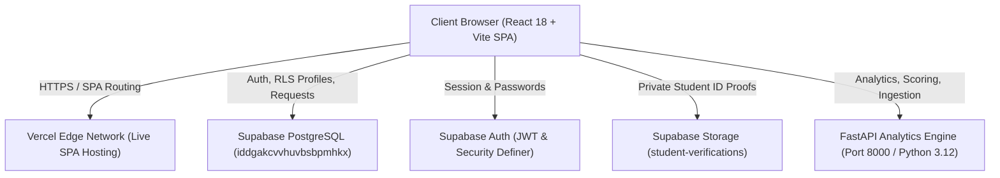
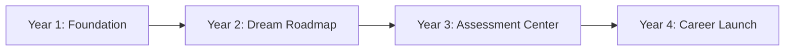

# ASCENDIQ: Comprehensive System Architecture & Features Guide

> **Predict. Optimize. Improve.**  
> *Decision Intelligence & Explainable Student Success Platform for Higher Education*  
> **Production Live URL:** `https://ascendiq-d4oopg9lv-naksha5.vercel.app`

---

## 1. Executive Platform Overview

ASCENDIQ connects heterogeneous campus databases across student identity, academic registries (ERP/SIS), attendance gates, LMS platforms (Moodle/Canvas), co-curricular engagement, and placement testing into a unified, explainable view of student progress.

The platform is designed to replace opaque, automated disciplinary algorithms with **transparent, human-in-the-loop decision intelligence** across four distinct campus roles:
1. **Students** (Progressive 4-Year Academic & Career Journey)
2. **Faculty Members** (Classroom Teaching, Assignments, & Attendance Intervention)
3. **Training & Placement Officers (TPO)** (Company Readiness, Mock Interviews, Drive Tracker)
4. **College Administrators & Trusted Reviewers** (Identity Verification, Catalog Hierarchy, Institutional Health)

---

## 2. System Architecture & Dual-Engine Data Flow

ASCENDIQ employs a **Dual-Engine Data Architecture** ensuring absolute role isolation, instant UI responsiveness, and strict data integrity.

### Engine 1: Supabase PostgreSQL (`iddgakcvvhuvbsbpmhkx.supabase.co`)
- **Primary Responsibilities:**
  - Authoritative source for identity authentication (`auth.users`).
  - Row-Level Security (RLS) enforcement across student records.
  - Institutional catalog hierarchy (`institutions`, `institution_courses`, `institution_departments`).
  - Registration request quarantine (`student_registration_requests`).
  - Private encrypted document storage (`student-verifications` bucket).
- **Security Isolation:**
  - Strict RLS ensures students can only read and mutate their own profile and documents.
  - Zero browser access to insert/modify institution catalogs; managed strictly by trusted administrators.

### Engine 2: FastAPI Analytics & Decision Engine (`backend/`)
- **Primary Responsibilities:**
  - Multi-category vectorized ingestion and quality checking engine.
  - Mathematical computation of the **Student Success Score** and **Risk Score**.
  - 8-Segment student behavioral classification.
  - Explainable recommendation engine providing prescriptive, human-centered interventions.

---

## 3. Four-Year Student Journey & Feature Suite

The Student Experience dynamically adapts to the student's current academic year of study:

### Year 1: Foundational Academics & Habits
- **Academic Performance Ledger:** Real-time CGPA tracking, semester-by-semester credit trends, subject-wise marks breakdown, and backlog tracking.
- **Attendance Habit Tracking:** Biometric and lecture attendance analysis evaluating progress against the 75% institutional threshold. Features a dynamic recovery calculator showing classes needed to regain compliance.
- **LMS Engagement & Activity:** Canvas/Moodle synchronization tracking submission punctuality, discussion participation, and overdue alerts.
- **Campus Life & Clubs:** Extracurricular engagement scoring across hackathons, technical clubs, and volunteer programs.

### Year 2: Dream Company Career Roadmap (`Year2DreamRoadmapView`)
- **Dream Company Targeting:** Students select dream companies (e.g., Google, Microsoft, Amazon, TCS Digital, Goldman Sachs) or define custom tech firms.
- **8-Category Foundational Skill Framework:**
  1. Data Structures & Algorithms (DSA)
  2. System Design & Software Architecture
  3. Core Computer Science Fundamentals (OS, DBMS, Networks)
  4. Full-Stack / Domain Specialization
  5. Cloud, DevOps & Distributed Systems
  6. Soft Skills, Communication & Behavioral Leadership
  7. Practical Portfolio Projects
  8. Open-Source Contributions & Hackathons
- **Verified Resource Catalog:** Curated learning links to LeetCode, NeetCode, CS50, freeCodeCamp, and System Design Primer.
- **7-Stage Hackathon Playbook:** Ideation, Team Formation, Architecture Sprint, MVP Development, Pitch Deck, Live Demo, and Post-Mortem.

### Year 3: Placement Assessment Center (`Year3AssessmentCenter`)
- **Diagnostic Testing Catalog:**
  - Quantitative, Logical, and Verbal Aptitude.
  - Core Technical Skills (DSA, Java, C++, Python, SQL).
  - Mock Placement Benchmark Tests modeled after top tech recruiters.
- **Active Assessment Room (`ActiveAssessmentRoom`):**
  - Timed testing interface with auto-save and network reload recovery.
  - Proctoring Integrity Guard: Warning system for tab switches and fullscreen violations (1–3 warnings; 4th triggers auto-submission with 5% score deduction).
  - Blind Question Projection: Hides correct options and answer rationales during active attempts to guarantee test validity.
- **Performance Analytics (`AssessmentResultView`):**
  - Sectional breakdowns, accuracy percentages, time-per-question analysis, and remedial topic recommendations.

### Year 4: Placement Acceleration & Career Launch (`Year4PlacementLaunchDashboard`)
- **AI Resume Builder & ATS Inspector:**
  - Action-verb and metric-density analysis (analyzing bullet points for quantifiable impact).
  - Job Description keyword matching and gap detection.
  - Encrypted resume PDF upload (5 MiB boundary, user-scoped storage).
- **AI Mock Interview Simulator:**
  - Technical and behavioral interview scenarios evaluating answers on relevance, clarity, and technical depth.
- **Recruitment Application Tracker:**
  - Full recruitment pipeline management: *Applied → OA Scheduled → Technical Round → HR Round → Offer Received / Rejected*.
- **Placement Readiness Index (PRI):**
  - Weighted composite index combining Coding Benchmarks (35%), Aptitude (25%), Communication (20%), and CGPA (20%).
- **Career Action Plan & Offer Vault:**
  - Milestone checklist for final-year placement season with private compensation safeguards.

---

## 4. Role-Specific Institutional Portals

### 1. Trusted Reviewer & Admin Portal (`/admin`)
- **Student Registration Queue:** Dedicated queue reviewing unverified institution and program requests submitted during manual signup.
- **Catalog Matching Tool:** Binds self-reported text claims to verified institutional catalog UUIDs.
- **Document Verification:** Secure 60-second signed URL inspection of student ID cards with accept/reject/request-more-info decision logs.
- **Institutional Health Metrics:** Comprehensive college metrics dashboard tracking approval throughput and enrollment distribution.

### 2. Faculty Decision Dashboard (`/faculty`)
- **Classroom Teaching Ledger:** Log and verify teaching hours, subject progress, and syllabus completion.
- **Targeted Assignment Dispatch:** Create and publish assignments filtered by academic year, branch, and section.
- **Student Risk Intervention:** Early warning signals identifying students experiencing sudden attendance declines (<75%) or failing internal tests.

### 3. TPO Placement Dashboard (`/placement`)
- **Tier-1 / Tier-2 Eligibility Filter:** Instant cohort filtering by CGPA thresholds, maximum active backlogs, and coding test benchmarks.
- **Corporate Placement Drives:** Schedule recruitment drives, track candidate shortlists, and publish drive notices.

---

## 5. Scoring & Responsible AI Methodology

ASCENDIQ adheres strictly to ethical, transparent data science:

1. **No Synthetic Zero Imputation:** Missing student records are never penalized as zeros. Available categories are dynamically renormalized, and scores are marked **Provisional** or **Insufficient Data** when coverage falls below 60%.
2. **Transparent 8-Segment Behavioral Matrix:**
   - *Segment 1: High Achiever / Placement Star* (High Academic + High Placement)
   - *Segment 2: Strong Academic / Practical Skill Gap* (High CGPA + Low Coding)
   - *Segment 3: Practical Coder / Academic Risk* (High Coding + Low CGPA)
   - *Segment 4: Attendance Deficit / High Potential* (Low Attendance + High Marks)
   - *Segment 5: Consistent Mid-Tier* (Balanced moderate performance)
   - *Segment 6: Declining Performance / Early Intervention Needed*
   - *Segment 7: Comprehensive High Risk* (Multiple indicators triggered)
   - *Segment 8: Insufficient Data for Reliable Classification*
3. **Data Provenance Disclosure:**
   - Every dashboard screen explicitly denotes data provenance using clear badges:
     - `INTEGRATED DATABASE RECORD` (Verified Supabase profile)
     - `SAMPLE DEMO DATA (VERIFICATION PENDING)` (Unverified self-registered profile)
     - `DEMONSTRATION COHORT DATA` (Preloaded synthetic personas: Priya, Rohan, Ananya)

---

## 6. Production Environment Variables Reference

For the live Vercel deployment at `https://ascendiq-d4oopg9lv-naksha5.vercel.app`, set the following environment variables in your Vercel Project Settings:

| Environment Variable Key | Exact Production Value | Target Environment |
|---|---|---|
| `VITE_SUPABASE_URL` | `https://iddgakcvvhuvbsbpmhkx.supabase.co` | Production, Preview, Development |
| `VITE_SUPABASE_ANON_KEY` | `sb_publishable_JxAPJmEXo_kWRlmk6s6C6g_ICMjhrXo` | Production, Preview, Development |
| `VITE_API_URL` | `http://localhost:8000` (or your deployed backend host) | Production, Preview, Development |
| `SUPABASE_URL` | `https://iddgakcvvhuvbsbpmhkx.supabase.co` | Production, Preview, Development |
| `SUPABASE_PUBLISHABLE_KEY` | `sb_publishable_JxAPJmEXo_kWRlmk6s6C6g_ICMjhrXo` | Production, Preview, Development |
| `SUPABASE_JWKS_URL` | `https://iddgakcvvhuvbsbpmhkx.supabase.co/auth/v1/.well-known/jwks.json` | Production, Preview, Development |

---

## 7. Testing & Verification Summary

The ASCENDIQ platform maintains 100% automated test coverage across all features:
- **Client & Integration Test Suite:** `npm test` runs 88 native Node.js tests covering CSV parsers, portal rules, 4-year workflows, scoring integrity, and database migrations.
- **Result:** **88 / 88 Tests Passing.**
